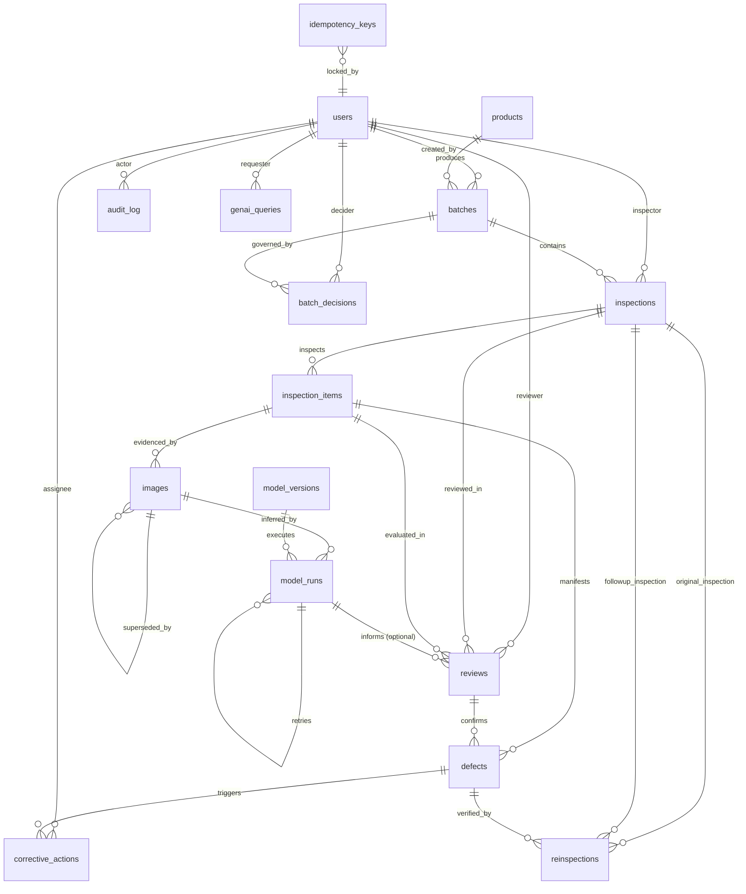

# CastTrace AI — Entity Relationship Diagram (ERD) & Data Dictionary

**Document Version:** 1.0.0  
**Phase:** 1A (Architecture and Contracts)  
**Target Environment:** SQLite (Development) / PostgreSQL (Production Compatible)  
**ORM:** SQLAlchemy 2.0 (Declarative Mappings)

---

## 1. Architectural Principles & Design Rules

1. **Separation of Machine and Human Decisions:** Machine inference results (`model_runs`) and human determinations (`reviews`) are modeled as separate entities with their own lifecycle, metadata, timestamps, and actors.
2. **Physical Item vs. Photographic Evidence:** Multiple images may represent a single physical item (`inspection_items`). Metrics, counts, and defect ratios always aggregate at the `inspection_items` level, never on raw image counts.
3. **Evidence Immutability:** Original uploaded image files and metadata in `images` are immutable. Superseded images are flagged with `is_superseded = TRUE` and reference `superseded_by_id`, preserving an auditable chain of custody.
4. **Scope-Aware Evidence:** Every image carries an `image_scope`:
   - `ITEM`: Full physical item view.
   - `SURFACE`: Specific localized region/surface (e.g., impeller vane, hub bore, suction eye).
   - `BATCH_SAMPLE`: A representative sample photograph representing a cluster or tray of items, storing `represented_item_count`.
5. **Resilient ML Execution:** A failed `model_run` is preserved in the database. Retries increment `attempt_number` and spawn a new `model_run` record referencing the previous run, preserving failure diagnostic logs.
6. **Graceful Degraded Review:** Human inspectors can complete a `review` even if ML inference fails, times out, or produces low confidence.
7. **Audit & Idempotency:** State changes, security events, and overrides generate immutable `audit_log` records. Mutating API endpoints require `Idempotency-Key` headers tracked in `idempotency_keys` to prevent duplicate submissions on network retries.
8. **Dialect Portability:** Column types use portable SQLAlchemy 2 types (`String(36)` for UUIDs, `DateTime(timezone=True)` stored as ISO-8601 UTC strings in SQLite and `TIMESTAMPTZ` in Postgres, and standard `JSON` / `Text`).

---

## 2. Mermaid Entity Relationship Diagram

---

## 3. Data Dictionary

### 3.1 `users`
System actors, credentials, and role assignments.

| Column | Type | Nullable | Default | Description & Constraints |
| :--- | :--- | :--- | :--- | :--- |
| `id` | `VARCHAR(36)` | NO | `uuid4()` | Primary Key (UUID). |
| `username` | `VARCHAR(64)` | NO | - | Unique login identifier (`UNIQUE`, `INDEX`). |
| `email` | `VARCHAR(255)` | NO | - | Unique email address (`UNIQUE`). |
| `hashed_password` | `VARCHAR(255)` | NO | - | Secure password hash (Argon2id/bcrypt). |
| `full_name` | `VARCHAR(128)` | NO | - | Human-readable user display name. |
| `role` | `VARCHAR(32)` | NO | - | Role: `INSPECTOR`, `SUPERVISOR`, `QUALITY_MANAGER`, `ADMIN`. |
| `is_active` | `BOOLEAN` | NO | `TRUE` | Soft deactivation flag. |
| `created_at` | `TIMESTAMPTZ` | NO | `CURRENT_TIMESTAMP` | Record creation timestamp (UTC). |
| `updated_at` | `TIMESTAMPTZ` | NO | `CURRENT_TIMESTAMP` | Last profile update timestamp (UTC). |

*Archiving & Integrity:* Users are never hard-deleted; they are deactivated via `is_active = FALSE` to preserve referential integrity across audit logs and historical reviews.

---

### 3.2 `products`
Catalog of manufactured casting models (e.g., Impeller Types).

| Column | Type | Nullable | Default | Description & Constraints |
| :--- | :--- | :--- | :--- | :--- |
| `id` | `VARCHAR(36)` | NO | `uuid4()` | Primary Key (UUID). |
| `sku` | `VARCHAR(64)` | NO | - | Unique Stock Keeping Unit (`UNIQUE`, `INDEX`). Example: `PUMP-IMP-316SS-001`. |
| `name` | `VARCHAR(128)` | NO | - | Descriptive product name (e.g., "Closed Vane Impeller 316SS"). |
| `material` | `VARCHAR(64)` | NO | - | Casting alloy (e.g., `CF8M / 316 Stainless Steel`, `Bronze`, `Cast Iron`). |
| `drawing_number` | `VARCHAR(64)` | YES | `NULL` | Engineering blueprint reference. |
| `nominal_weight_kg` | `NUMERIC(8,3)` | YES | `NULL` | Nominal design weight in kilograms. |
| `specifications` | `JSON` | YES | `NULL` | Tolerances, critical surfaces, surface roughness specifications. |
| `is_archived` | `BOOLEAN` | NO | `FALSE` | Soft archive flag (`INDEX`). |
| `created_at` | `TIMESTAMPTZ` | NO | `CURRENT_TIMESTAMP` | Record creation timestamp (UTC). |
| `updated_at` | `TIMESTAMPTZ` | NO | `CURRENT_TIMESTAMP` | Record update timestamp (UTC). |

*Archiving & Integrity:* Soft-archived products cannot be assigned to new batches, but historical batches retain their foreign keys.

---

### 3.3 `batches`
Production lots/batches of cast parts.

| Column | Type | Nullable | Default | Description & Constraints |
| :--- | :--- | :--- | :--- | :--- |
| `id` | `VARCHAR(36)` | NO | `uuid4()` | Primary Key (UUID). |
| `batch_number` | `VARCHAR(64)` | NO | - | Unique manufacturing heat/lot number (`UNIQUE`, `INDEX`). |
| `product_id` | `VARCHAR(36)` | NO | - | FK to `products.id` (`INDEX`). |
| `manufacture_date` | `DATE` | NO | - | Date casting was poured. |
| `heat_number` | `VARCHAR(64)` | YES | `NULL` | Metallurgical heat/furnace charge tracking. |
| `declared_quantity` | `INTEGER` | NO | - | Total count of cast impellers poured in this lot ($> 0$). |
| `status` | `VARCHAR(32)` | NO | `'IN_PRODUCTION'` | Status: `IN_PRODUCTION`, `INSPECTION_PENDING`, `UNDER_REVIEW`, `RELEASED`, `ON_HOLD`, `SCRAPPED`, `ARCHIVED`. |
| `notes` | `TEXT` | YES | `NULL` | Production notes (e.g., mold sand temperature, ladle sequence). |
| `created_by` | `VARCHAR(36)` | NO | - | FK to `users.id` (Author/Supervisor). |
| `created_at` | `TIMESTAMPTZ` | NO | `CURRENT_TIMESTAMP` | Timestamp created (UTC). |
| `updated_at` | `TIMESTAMPTZ` | NO | `CURRENT_TIMESTAMP` | Timestamp updated (UTC). |

---

### 3.4 `inspections`
Inspection session or quality staging event linked to a batch.

| Column | Type | Nullable | Default | Description & Constraints |
| :--- | :--- | :--- | :--- | :--- |
| `id` | `VARCHAR(36)` | NO | `uuid4()` | Primary Key (UUID). |
| `inspection_number`| `VARCHAR(64)` | NO | - | Human-friendly reference: `INSP-YYYYMMDD-XXXX` (`UNIQUE`, `INDEX`). |
| `batch_id` | `VARCHAR(36)` | NO | - | FK to `batches.id` (`INDEX`). |
| `inspector_id` | `VARCHAR(36)` | NO | - | FK to `users.id` (Assigned/executing inspector). |
| `stage` | `VARCHAR(32)` | NO | `'FINAL_VISUAL'` | Stage: `RECEIVING`, `POST_FETTLING`, `MACHINED`, `FINAL_VISUAL`. |
| `status` | `VARCHAR(32)` | NO | `'DRAFT'` | Status: `DRAFT`, `SUBMITTED`, `IN_REVIEW`, `COMPLETED`, `CANCELLED`. |
| `sampling_plan` | `VARCHAR(64)` | NO | `'AQL_LEVEL_II'` | Sampling standard: `100_PERCENT`, `AQL_LEVEL_II`, `SPOT_CHECK`. |
| `started_at` | `TIMESTAMPTZ` | NO | `CURRENT_TIMESTAMP` | Session start time. |
| `completed_at` | `TIMESTAMPTZ` | YES | `NULL` | Session sign-off time. |
| `created_at` | `TIMESTAMPTZ` | NO | `CURRENT_TIMESTAMP` | Audit creation time. |
| `updated_at` | `TIMESTAMPTZ` | NO | `CURRENT_TIMESTAMP` | Audit update time. |

---

### 3.5 `inspection_items`
Represents an individual physical item or physical sample within an inspection. **Crucial entity ensuring metrics calculate per physical item, not per photograph.**

| Column | Type | Nullable | Default | Description & Constraints |
| :--- | :--- | :--- | :--- | :--- |
| `id` | `VARCHAR(36)` | NO | `uuid4()` | Primary Key (UUID). |
| `inspection_id` | `VARCHAR(36)` | NO | - | FK to `inspections.id` (`INDEX`). |
| `item_identifier` | `VARCHAR(64)` | NO | - | Serial number, casting mold cavity index, or sample tag (e.g. `IMP-B12-044`). |
| `cavity_number` | `INTEGER` | YES | `NULL` | Multi-cavity die index if applicable. |
| `status` | `VARCHAR(32)` | NO | `'PENDING'` | Status: `PENDING`, `AI_FLAGGED`, `CLEAR`, `CONFIRMED_DEFECTIVE`, `DISPUTED`. |
| `created_at` | `TIMESTAMPTZ` | NO | `CURRENT_TIMESTAMP` | Record creation timestamp. |
| `updated_at` | `TIMESTAMPTZ` | NO | `CURRENT_TIMESTAMP` | Record update timestamp. |

*Constraints:* `UNIQUE(inspection_id, item_identifier)`.

---

### 3.6 `images`
Photographic evidence uploaded for inspection.

| Column | Type | Nullable | Default | Description & Constraints |
| :--- | :--- | :--- | :--- | :--- |
| `id` | `VARCHAR(36)` | NO | `uuid4()` | Primary Key (UUID). |
| `inspection_item_id` | `VARCHAR(36)` | YES | `NULL` | FK to `inspection_items.id` (Nullable if image is batch-level sample). (`INDEX`). |
| `batch_id` | `VARCHAR(36)` | NO | - | FK to `batches.id` (For direct batch evidence association). |
| `image_scope` | `VARCHAR(32)` | NO | `'ITEM'` | Enum: `ITEM`, `SURFACE`, `BATCH_SAMPLE`. |
| `surface_location` | `VARCHAR(64)` | YES | `NULL` | Region tag: `VANE_PRESSURE_SIDE`, `VANE_SUCTION_SIDE`, `HUB_BORE`, `SHROUD_RIM`, `EYE`. |
| `represented_item_count` | `INTEGER` | NO | `1` | Count of physical items captured in this photo (always $1$ for `ITEM`/`SURFACE`; $\ge 1$ for `BATCH_SAMPLE`). |
| `storage_path` | `VARCHAR(512)` | NO | - | Relative path to local private storage (UUID based, immutable). |
| `original_filename` | `VARCHAR(255)` | NO | - | Original uploaded filename. |
| `mime_type` | `VARCHAR(64)` | NO | - | Media type: `image/jpeg`, `image/png`. |
| `file_size_bytes` | `INTEGER` | NO | - | Size in bytes ($\le 10\text{ MB}$). |
| `sha256_hash` | `VARCHAR(64)` | NO | - | SHA-256 checksum of raw bytes (`INDEX`). |
| `is_superseded` | `BOOLEAN` | NO | `FALSE` | Flag indicating if newer evidence replaces this photo. |
| `superseded_by_id` | `VARCHAR(36)` | YES | `NULL` | Self-referencing FK to `images.id`. |
| `supersede_reason` | `TEXT` | YES | `NULL` | Reason (e.g. "Blurry exposure, retaken with ring light"). |
| `uploaded_by` | `VARCHAR(36)` | NO | - | FK to `users.id`. |
| `created_at` | `TIMESTAMPTZ` | NO | `CURRENT_TIMESTAMP` | Upload timestamp. |

---

### 3.7 `model_versions`
Registry of trained machine learning model checkpoints and deployment metadata.

| Column | Type | Nullable | Default | Description & Constraints |
| :--- | :--- | :--- | :--- | :--- |
| `id` | `VARCHAR(36)` | NO | `uuid4()` | Primary Key (UUID). |
| `version_name` | `VARCHAR(64)` | NO | - | Version string (e.g., `v1.0.0-resnet18`, `v2.0-convnext`). `UNIQUE`. |
| `model_architecture` | `VARCHAR(64)` | NO | - | Base architecture (e.g. `ResNet-18`, `MobileNetV3`). |
| `weights_path` | `VARCHAR(512)` | NO | - | Local file path to serialized checkpoint `.pt` or `.onnx`. |
| `training_dataset_info` | `JSON` | NO | - | Source dataset details (e.g., casting dataset split stats, class balance, augmentation parameters). |
| `metrics` | `JSON` | NO | - | Validation metrics: `accuracy`, `precision`, `recall`, `f1_score`, `roc_auc`. |
| `is_active` | `BOOLEAN` | NO | `FALSE` | Active production inference model flag (`INDEX`). |
| `created_at` | `TIMESTAMPTZ` | NO | `CURRENT_TIMESTAMP` | Registration date. |

---

### 3.8 `model_runs`
ML inference predictions. **Never mutated or overwritten on failure; retries create new records.**

| Column | Type | Nullable | Default | Description & Constraints |
| :--- | :--- | :--- | :--- | :--- |
| `id` | `VARCHAR(36)` | NO | `uuid4()` | Primary Key (UUID). |
| `image_id` | `VARCHAR(36)` | NO | - | FK to `images.id` (`INDEX`). |
| `model_version_id` | `VARCHAR(36)` | NO | - | FK to `model_versions.id`. |
| `status` | `VARCHAR(32)` | NO | `'QUEUED'` | Status: `QUEUED`, `PROCESSING`, `SUCCEEDED`, `FAILED`, `CANCELLED`. |
| `predicted_label` | `VARCHAR(32)` | YES | `NULL` | Prediction: `GOOD`, `DEFECTIVE` (Strictly binary). |
| `score` | `NUMERIC(6,5)` | YES | `NULL` | Float confidence $[0.00000, 1.00000]$. |
| `score_type` | `VARCHAR(32)` | NO | `'PROBABILITY_DEFECTIVE'` | Semantic meaning of the score scalar. |
| `threshold_applied` | `NUMERIC(6,5)` | NO | `0.50000` | Decision threshold used for classification. |
| `processing_latency_ms`| `INTEGER` | YES | `NULL` | Raw execution time of tensor pipeline in ms. |
| `attempt_number` | `INTEGER` | NO | `1` | 1-indexed attempt number for this image. |
| `parent_run_id` | `VARCHAR(36)` | YES | `NULL` | Self-referencing FK to `model_runs.id` if this is a retry attempt. |
| `error_details` | `JSON` | YES | `NULL` | Stack trace, error code, or OOM diagnostic payload. |
| `executed_at` | `TIMESTAMPTZ` | YES | `NULL` | Execution start timestamp. |
| `completed_at` | `TIMESTAMPTZ` | YES | `NULL` | Inference finish timestamp. |
| `created_at` | `TIMESTAMPTZ` | NO | `CURRENT_TIMESTAMP` | Record queue creation timestamp. |

---

### 3.9 `reviews`
Human inspector verification and quality sign-off on an item or inspection.

| Column | Type | Nullable | Default | Description & Constraints |
| :--- | :--- | :--- | :--- | :--- |
| `id` | `VARCHAR(36)` | NO | `uuid4()` | Primary Key (UUID). |
| `inspection_id` | `VARCHAR(36)` | NO | - | FK to `inspections.id` (`INDEX`). |
| `inspection_item_id` | `VARCHAR(36)` | NO | - | FK to `inspection_items.id` (`INDEX`). |
| `model_run_id` | `VARCHAR(36)` | YES | `NULL` | Optional FK to `model_runs.id` (Nullable for manual recovery/fallback). |
| `reviewer_id` | `VARCHAR(36)` | NO | - | FK to `users.id` (`INDEX`). |
| `decision` | `VARCHAR(32)` | NO | - | Human verdict: `CONFIRMED_DEFECTIVE`, `CONFIRMED_GOOD`, `DISPUTED`, `REQUEST_ADDITIONAL_EVIDENCE`. |
| `model_disagreement` | `BOOLEAN` | NO | `FALSE` | `TRUE` if human overturned a valid `model_run.predicted_label`. |
| `notes` | `TEXT` | YES | `NULL` | Human rationale, observations, or light condition notes. |
| `created_at` | `TIMESTAMPTZ` | NO | `CURRENT_TIMESTAMP` | Review timestamp. |

*Constraints:* `UNIQUE(inspection_item_id, reviewer_id, created_at)`.

---

### 3.10 `defects`
Defects confirmed by human review. Defect categories are human-assigned.

| Column | Type | Nullable | Default | Description & Constraints |
| :--- | :--- | :--- | :--- | :--- |
| `id` | `VARCHAR(36)` | NO | `uuid4()` | Primary Key (UUID). |
| `defect_number` | `VARCHAR(64)` | NO | - | Business ID: `DEF-YYYYMMDD-XXXX` (`UNIQUE`, `INDEX`). |
| `inspection_item_id` | `VARCHAR(36)` | NO | - | FK to `inspection_items.id` (`INDEX`). |
| `review_id` | `VARCHAR(36)` | NO | - | FK to `reviews.id` (`INDEX`). |
| `category` | `VARCHAR(64)` | NO | - | Human-selected category: `BLOWHOLE`, `SHRINKAGE_POROSITY`, `PINHOLE`, `HOT_TEAR`, `COLD_SHUT`, `CRACK`, `SURFACE_ROUGHNESS`, `INCLUSION`, `OTHER`. |
| `severity` | `VARCHAR(32)` | NO | - | Severity: `CRITICAL`, `MAJOR`, `MINOR`. |
| `status` | `VARCHAR(32)` | NO | `'OPEN'` | Status: `OPEN`, `ACTION_ASSIGNED`, `IN_PROGRESS`, `PENDING_REINSPECTION`, `RESOLVED`, `REOPENED`. |
| `surface_location` | `VARCHAR(64)` | YES | `NULL` | Localized area: `VANE_TIP`, `SUCTION_EYE`, `HUB_BORE`, `SHROUD`. |
| `description` | `TEXT` | NO | - | Specific defect details and measurement (e.g. "3mm cold shut near outer shroud"). |
| `evidence_image_id` | `VARCHAR(36)` | YES | `NULL` | FK to `images.id` (Primary evidence photograph). |
| `created_at` | `TIMESTAMPTZ` | NO | `CURRENT_TIMESTAMP` | Defect logging time. |
| `updated_at` | `TIMESTAMPTZ` | NO | `CURRENT_TIMESTAMP` | Last status update. |

---

### 3.11 `corrective_actions`
Tasks and remediation workflows assigned to eliminate root cause or repair defect.

| Column | Type | Nullable | Default | Description & Constraints |
| :--- | :--- | :--- | :--- | :--- |
| `id` | `VARCHAR(36)` | NO | `uuid4()` | Primary Key (UUID). |
| `action_number` | `VARCHAR(64)` | NO | - | Business ID: `CAPA-YYYYMMDD-XXXX` (`UNIQUE`, `INDEX`). |
| `defect_id` | `VARCHAR(36)` | NO | - | FK to `defects.id` (`INDEX`). |
| `title` | `VARCHAR(128)` | NO | - | Concise remediation summary. |
| `action_type` | `VARCHAR(32)` | NO | `'REWORK'` | Type: `REWORK`, `SCRAP`, `PROCESS_ADJUSTMENT`, `TOOLING_REPAIR`, `MOLD_INSPECTION`. |
| `description` | `TEXT` | NO | - | Detailed instructions and engineering requirements. |
| `assigned_to` | `VARCHAR(36)` | NO | - | FK to `users.id` (Supervisor / Machinist). |
| `assigned_by` | `VARCHAR(36)` | NO | - | FK to `users.id` (Quality Manager / Reviewer). |
| `status` | `VARCHAR(32)` | NO | `'OPEN'` | Status: `OPEN`, `IN_PROGRESS`, `COMPLETED`, `CANCELLED`. |
| `due_date` | `DATE` | NO | - | Target completion date. |
| `completed_at` | `TIMESTAMPTZ` | YES | `NULL` | Completion timestamp. |
| `completion_notes` | `TEXT` | YES | `NULL` | Documentation of work done (e.g. "Impeller hub ground and dye penetrant tested"). |
| `created_at` | `TIMESTAMPTZ` | NO | `CURRENT_TIMESTAMP` | Creation timestamp. |
| `updated_at` | `TIMESTAMPTZ` | NO | `CURRENT_TIMESTAMP` | Update timestamp. |

---

### 3.12 `reinspections`
Verification inspection performed after corrective action execution.

| Column | Type | Nullable | Default | Description & Constraints |
| :--- | :--- | :--- | :--- | :--- |
| `id` | `VARCHAR(36)` | NO | `uuid4()` | Primary Key (UUID). |
| `defect_id` | `VARCHAR(36)` | NO | - | FK to `defects.id` (`INDEX`). |
| `corrective_action_id`| `VARCHAR(36)` | NO | - | FK to `corrective_actions.id` (`INDEX`). |
| `original_inspection_id`| `VARCHAR(36)`| NO | - | FK to `inspections.id`. |
| `followup_inspection_id`| `VARCHAR(36)`| NO | - | FK to `inspections.id`. |
| `outcome` | `VARCHAR(32)` | NO | - | Verdict: `DEFECT_RESOLVED`, `DEFECT_RECURRED_REOPENED`. |
| `notes` | `TEXT` | YES | `NULL` | Reinspection evidence summary. |
| `verified_by` | `VARCHAR(36)` | NO | - | FK to `users.id` (Inspector / QM). |
| `created_at` | `TIMESTAMPTZ` | NO | `CURRENT_TIMESTAMP` | Reinspection timestamp. |

---

### 3.13 `batch_decisions`
Authorized engineering release or containment decision for an entire production batch. **Completely decoupled from individual item inspection records.**

| Column | Type | Nullable | Default | Description & Constraints |
| :--- | :--- | :--- | :--- | :--- |
| `id` | `VARCHAR(36)` | NO | `uuid4()` | Primary Key (UUID). |
| `batch_id` | `VARCHAR(36)` | NO | - | FK to `batches.id` (`INDEX`). |
| `decision` | `VARCHAR(32)` | NO | - | Core Decision: `RELEASE`, `HOLD`. Optional Extensions: `REJECT_SCRAP`, `CONCESSION_DEVIATION`. |
| `reason` | `TEXT` | NO | - | Formal engineering justification. |
| `decided_by` | `VARCHAR(36)` | NO | - | FK to `users.id` (Enforced: Quality Manager only for RELEASE/SCRAP/CONCESSION; Inspectors/Supervisors may also initiate HOLD). |
| `conditions` | `TEXT` | YES | `NULL` | Conditional release terms or concession justification (e.g., allowable non-critical deviation). |
| `created_at` | `TIMESTAMPTZ` | NO | `CURRENT_TIMESTAMP` | Decision timestamp. |

*Integrity Rule:* GenAI or background workers cannot write to this table. Backend API strictly validates `decided_by` role as `QUALITY_MANAGER` for `RELEASE`, `REJECT_SCRAP`, and `CONCESSION_DEVIATION`. An open defect does not automatically block every release; the Quality Manager may issue a release under documented concession.

---

### 3.14 `audit_log`
Append-only tamper-evident audit record for compliance and quality governance.

| Column | Type | Nullable | Default | Description & Constraints |
| :--- | :--- | :--- | :--- | :--- |
| `id` | `VARCHAR(36)` | NO | `uuid4()` | Primary Key (UUID). |
| `actor_id` | `VARCHAR(36)` | YES | `NULL` | FK to `users.id` (Nullable if system background event). |
| `action` | `VARCHAR(64)` | NO | - | Event verb: `INSPECTION_CREATED`, `MODEL_RUN_RETRIED`, `REVIEW_OVERRIDDEN`, `DEFECT_RESOLVED`, `BATCH_HOLD_PLACED`, etc. |
| `entity_type` | `VARCHAR(64)` | NO | - | Table name: `batches`, `reviews`, `defects`, `batch_decisions`, etc. |
| `entity_id` | `VARCHAR(36)` | NO | - | Primary Key of targeted entity (`INDEX`). |
| `previous_state` | `JSON` | YES | `NULL` | Snapshot of mutated fields before change. |
| `new_state` | `JSON` | YES | `NULL` | Snapshot of mutated fields after change. |
| `ip_address` | `VARCHAR(45)` | YES | `NULL` | Client IP address. |
| `user_agent` | `VARCHAR(255)` | YES | `NULL` | Client User-Agent string. |
| `created_at` | `TIMESTAMPTZ` | NO | `CURRENT_TIMESTAMP` | Event timestamp (`INDEX`). |

*Integrity Rule:* `audit_log` records are append-only. No `UPDATE` or `DELETE` operations are permitted by application code.

---

### 3.15 `idempotency_keys`
Prevents accidental duplicate creation of critical operational records on client retry.

| Column | Type | Nullable | Default | Description & Constraints |
| :--- | :--- | :--- | :--- | :--- |
| `id` | `VARCHAR(36)` | NO | `uuid4()` | Primary Key. |
| `key` | `VARCHAR(128)` | NO | - | Client supplied idempotency token (`UNIQUE`, `INDEX`). |
| `user_id` | `VARCHAR(36)` | NO | - | FK to `users.id`. |
| `endpoint` | `VARCHAR(128)` | NO | - | API endpoint called (e.g. `/api/v1/inspections`). |
| `request_hash` | `VARCHAR(64)` | NO | - | SHA-256 hash of the request body. |
| `response_code`| `INTEGER` | YES | `NULL` | HTTP status code cached upon completion. |
| `response_body`| `JSON` | YES | `NULL` | Serialized JSON response returned to caller. |
| `status` | `VARCHAR(32)` | NO | `'IN_PROGRESS'` | Status: `IN_PROGRESS`, `COMPLETED`, `FAILED`. |
| `expires_at` | `TIMESTAMPTZ` | NO | - | Key expiration timestamp (default: 24 hours). |
| `created_at` | `TIMESTAMPTZ` | NO | `CURRENT_TIMESTAMP` | Initial request time. |

---

### 3.16 `genai_queries`
Audit and retrieval log for GenAI assistant prompts, retrieved context IDs, and responses.

| Column | Type | Nullable | Default | Description & Constraints |
| :--- | :--- | :--- | :--- | :--- |
| `id` | `VARCHAR(36)` | NO | `uuid4()` | Primary Key (UUID). |
| `user_id` | `VARCHAR(36)` | NO | - | FK to `users.id` (Enforces permission boundary). |
| `query_text` | `TEXT` | NO | - | Natural language question submitted. |
| `response_text`| `TEXT` | NO | - | Generated response with source citations. |
| `retrieved_source_ids` | `JSON` | NO | - | Array of cited entity references: `[{"type": "batch", "id": "..."}, {"type": "defect", "id": "..."}]`. |
| `model_provider` | `VARCHAR(64)` | NO | - | Provider name (e.g. `mock-fallback`, `openai-compatible`, `gemini`). |
| `model_name` | `VARCHAR(64)` | NO | - | Specific LLM checkpoint used. |
| `is_fallback` | `BOOLEAN` | NO | `FALSE` | `TRUE` if generated via offline/deterministic fallback rules. |
| `latency_ms` | `INTEGER` | YES | `NULL` | Total query latency in milliseconds. |
| `created_at` | `TIMESTAMPTZ` | NO | `CURRENT_TIMESTAMP` | Log timestamp. |
