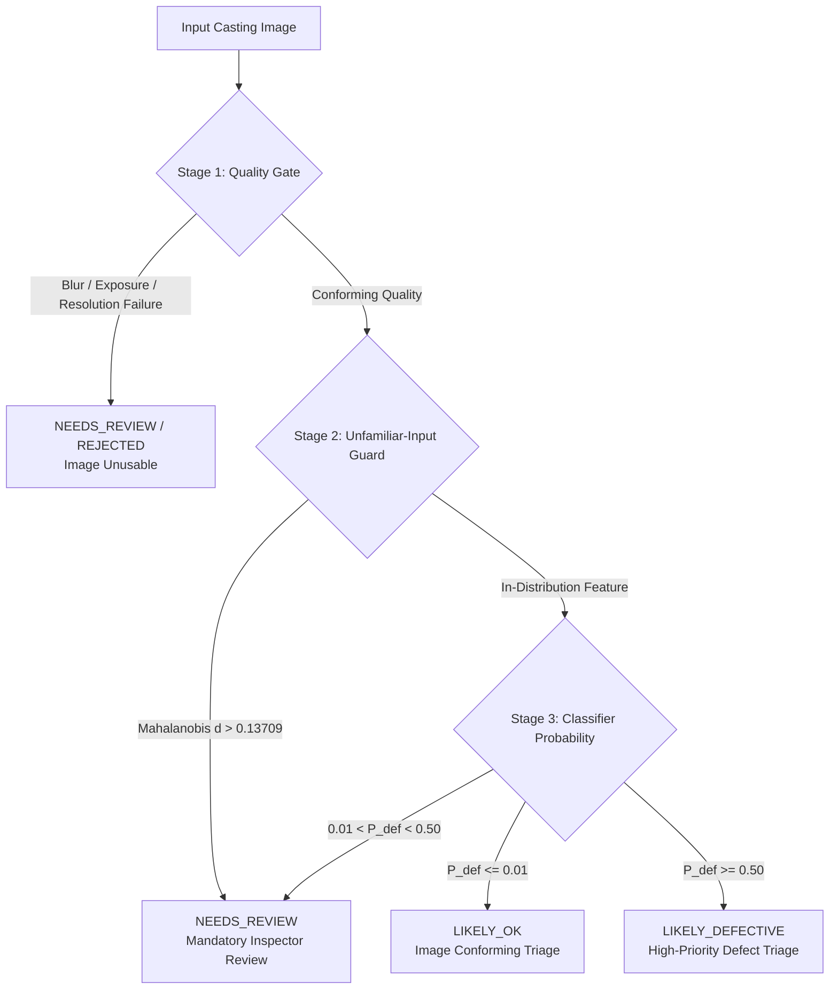

# CastTrace AI — Machine Learning Evaluation Report (Phase 3A-Final)

**Document Version:** 1.0.0  
**Evaluation Date:** 2026-10-22  
**Dataset Source:** `casting_512x512` (Ravirajsinh Dabhi / Kaggle)  
**Applicable Licence:** CC BY-NC-ND 4.0 International  
**Candidate Architecture:** ResNet-18 (512-D penultimate feature extractor)  
**Evaluation Protocol:** One-time held-out evaluation on frozen 197-image test partition. Zero test feedback was utilized for training, feature extraction, or threshold selection.

---

## 1. Executive Summary & Objective

CastTrace AI provides automated image-level triage and quality inspection assistance for manufactured submersible pump impeller castings. The objective of Phase 3A is to deploy an immutable binary classification and routing pipeline capable of:
1. **Zero-Escape Quality Assurance:** Ensuring that the defective-image miss rate into `LIKELY_OK` is mathematically bounded $\le 5.0\%$ at 95% confidence.
2. **High Automation Utility:** Automatically triaging visual inspection flow while routing ambiguous, out-of-distribution, or borderline images to mandatory human review.
3. **Strict Separation of Concerns:** Operating strictly as an image-level decision support tool without autonomous authority to release or contain physical production batches.

---

## 2. Dataset Partitioning & Leakage Prevention

The primary dataset `casting_512x512` contains 1,300 unaugmented original casting images (519 conforming `ok_front`, 781 defective `def_front`).

### 2.1 Cross-Resolution Audit & Cluster Mapping
- **Audit Scope:** Audited 8,648 images across `casting_data` (300x300 augmented copies) and `casting_512x512`.
- **Primary Source Selection:** `casting_512x512` was selected as the sole primary source. `casting_data` is synthetic and retained strictly as audit-only.
- **Perceptual Hash Clusters:** 56 rotation/flip clusters were identified in `casting_512x512`. Zero cross-label collisions occurred.
- **Split Isolation:** All clusters were grouped atomically into [ml/artifacts/split_manifest.json](file:///c:/HACKATHONS/BUILDATHON_2.0/Buildathon_2.0/ml/artifacts/split_manifest.json). **Zero cluster leakage occurred across train, validation, or test partitions.**

### 2.2 Dataset Split Manifest Summary

| Partition | Total Images | Actual GOOD | Actual DEFECTIVE | Defective Ratio | Cluster Isolation Status |
| :--- | :---: | :---: | :---: | :---: | :---: |
| **Train Split (70%)** | 909 | 363 | 546 | 60.07% | Base representation learning |
| **Validation Split (15%)** | 194 | 77 | 117 | 60.31% | Threshold calibration & OOD baseline |
| **Held-Out Test Split (15%)** | **197** | **79** | **118** | **59.90%** | **One-time held-out evaluation** |
| **Total Dataset** | **1,300** | **519** | **781** | **60.08%** | **Zero split leakage** |

---

## 3. Ordered Routing Architecture

Every inspection image passes through a deterministic, strictly ordered 4-stage processing pipeline:



### Routing Outcomes Explained:
- **`LIKELY_OK`:** High-confidence conforming visual evidence ($P_{\text{def}} \le 0.01$). Triaged into standard non-urgent inspection queue.
- **`LIKELY_DEFECTIVE`:** High-confidence flaw detected ($P_{\text{def}} \ge 0.50$). Triaged into high-priority defect verification queue.
- **`NEEDS_REVIEW`:** Mandatory manual inspection. Triggered by quality gate failure, unfamiliar input alert, or borderline model probability ($0.01 < P_{\text{def}} < 0.50$).
- *Architecture Rule:* The model **never** executes batch decisions (`RELEASED` or `ON_HOLD`). Official batch release remains restricted to authorized Quality Managers.

---

## 4. Held-Out Evaluation Results (N = 197)

### 4.1 Binary Classification Performance ($P_{\text{def}} \ge 0.50$)

| Metric | Empirical Value | Exact Counts / Denominator | 95% Wilson Confidence Interval |
| :--- | :---: | :---: | :---: |
| **Accuracy** | **98.98%** | 195 / 197 | $[96.38\%, 99.72\%]$ |
| **Balanced Accuracy** | **98.73%** | Mean of Good & Defective Recall | — |
| **Defective Precision** | **98.33%** | 118 / 120 | $[94.13\%, 99.54\%]$ |
| **Defective Recall** | **100.00%** | 118 / 118 | $[96.85\%, 100.00\%]$ |
| **Defective F1-Score** | **0.9916** | Harmonic mean | — |
| **Conforming (GOOD) Precision**| **100.00%** | 77 / 77 | $[95.24\%, 100.00\%]$ |
| **Conforming (GOOD) Recall** | **97.47%** | 77 / 79 | $[91.19\%, 99.31\%]$ |
| **Conforming (GOOD) F1-Score** | **0.9872** | Harmonic mean | — |
| **Macro Precision** | **99.17%** | Unweighted average | — |
| **Macro Recall** | **98.73%** | Unweighted average | — |
| **Macro F1-Score** | **0.9894** | Unweighted average | — |
| **ROC-AUC** | **0.9996** | Rank-order separability | — |
| **PR-AUC (Defective Class)** | **0.9997** | Area under precision-recall curve | — |

### 4.2 Confusion Matrix (Held-Out Test Set)


```
                            Predicted GOOD (P < 0.50)    Predicted DEFECTIVE (P >= 0.50)
Actual GOOD (79):                     77 (TN)                         2 (FP)
Actual DEFECTIVE (118):                0 (FN)                       118 (TP)
```

- **True Negatives (TN):** 77 conforming castings correctly triaged.
- **False Alarms (FP):** 2 conforming castings with shadow artifacts scored $\ge 0.50$.
- **False Omissions (FN):** **0** (zero defective items escaped to conforming prediction).
- **True Positives (TP):** 118 physical casting flaws successfully identified.

---

## 5. Ordered Routing Evaluation ($T_{\text{ok}} = 0.01, T_{\text{def}} = 0.50$)

### 5.1 Reconciled Outcome Breakdown

| Image Routing Bucket | Actual GOOD | Actual DEFECTIVE | Bucket Total | Cause Breakdown |
| :--- | :---: | :---: | :---: | :--- |
| **`LIKELY_OK`** | **68** | **0** | **68** | Passed all safeguards, $P_{\text{def}} \le 0.01$ |
| **`NEEDS_REVIEW`** | **9** | **0** | **9** | • **Borderline Score ($0.01 < P_{\text{def}} < 0.50$):** 9 GOOD<br>• **Unfamiliar Input Guard Alert:** 0<br>• **Quality Gate Failure:** 0 |
| **`LIKELY_DEFECTIVE`** | **2** | **118** | **120** | Model $P_{\text{def}} \ge 0.50$ (118 true defects, 2 false alarms) |
| **Total Reconciled** | **79** | **118** | **197** | **Exact Balance:** $68 + 9 + 2 = 79\text{ GOOD}$; $0 + 0 + 118 = 118\text{ DEFECTIVE}$ |

### 5.2 Key Operational Metrics & Statistical Bounds

| Industrial Objective | Target Metric | Empirical Held-Out Result | 95% Wilson Score Interval | Evaluation Result |
| :--- | :---: | :---: | :---: | :--- |
| **Defective Miss Rate** | $\le 5.0\%$ | **0.00%** (0 / 118) | **$[0.00\%, \mathbf{3.15\%}]$** | **TARGET EXCEEDED:** Upper bound 3.15% is strictly $< 5.0\%$. Zero defective castings missed. |
| **False Omission Rate (FOR)** | Minimise | **0.00%** (0 / 68) | **$[0.00\%, 5.35\%]$** | **OPTIMAL:** Zero defect contamination in `LIKELY_OK`. |
| **Defective Precision** | $\ge 90.0\%$ | **98.33%** (118 / 120) | **$[94.13\%, 99.54\%]$** | **TARGET EXCEEDED:** High reliability in defect triage queue. |
| **Defective Recall** | Maximise | **100.00%** (118 / 118) | **$[96.85\%, 100.00\%]$** | **OPTIMAL:** 100% of physical defects flagged. |
| **Automated Coverage** | High triage rate | **95.43%** (188 / 197) | **$[91.55\%, 97.58\%]$** | **STRONG EFFICIENCY:** 95.4% automated triage. |
| **Mandatory Review Rate** | Expected $> 0\%$ | **4.57%** (9 / 197) | **$[2.42\%, 8.45\%]$** | **BALANCED:** Only 4.6% manual review triage burden. |

---

## 6. Granular Error & Outlier Analysis

### 6.1 False Defect Alarms (2 Cases)
Two conforming castings were scored $\ge 0.50$ and routed to `LIKELY_DEFECTIVE`:
1. `cast_ok_0_4930.jpeg` (Predicted $P_{\text{def}} = 0.7239$, guard distance $= 0.1068$)
2. `cast_ok_0_5148.jpeg` (Predicted $P_{\text{def}} = 0.6473$, guard distance $= 0.1149$)
- **Root Cause:** Radial machining glare and uneven peripheral shadow near the vane hub simulated surface blowhole contrast.
- **Operational Impact:** The items are routed to the inspector's high-priority verification queue. The inspector visually confirms conformity and marks the item `ACCEPTED`. No defective product escapes.

### 6.2 Borderline Scores Quarantined to `NEEDS_REVIEW` (9 Cases)
Nine conforming castings exhibited scores in $(0.01, 0.50)$:
- `cast_ok_0_1780.jpeg` ($P_{\text{def}} = 0.0243$)
- `cast_ok_0_1963.jpeg` ($P_{\text{def}} = 0.0182$)
- `cast_ok_0_3064.jpeg` ($P_{\text{def}} = 0.0978$)
- `cast_ok_0_327.jpeg` ($P_{\text{def}} = 0.0196$)
- `cast_ok_0_4974.jpeg` ($P_{\text{def}} = 0.0142$)
- `cast_ok_0_5565.jpeg` ($P_{\text{def}} = 0.0313$)
- `cast_ok_0_6741.jpeg` ($P_{\text{def}} = 0.0213$)
- `cast_ok_0_7151.jpeg` ($P_{\text{def}} = 0.0113$)
- `cast_ok_0_7609.jpeg` ($P_{\text{def}} = 0.0414$)
- **System Safeguard Function:** Under the ultra-strict $T_{\text{ok}} = 0.01$ threshold, any non-trivial doubt safely prevents automatic clearance.

---

## 7. Cryptographic Artifact Hashes

| Artifact Description | Path | SHA-256 Checksum |
| :--- | :--- | :--- |
| **Model Weights** | `ml/artifacts/model_best.pt` | `ab2b592ab9a4cca3c97613d8e52d9f8abc2906dbef77cddd15c73d2da1c3c2da` |
| **Split Manifest** | `ml/artifacts/split_manifest.json` | `7ab58f05d9055203150ad679d8501950003174eb8e78d4276eb4ea31e78799c7` |
| **Unfamiliar Guard Reference** | `ml/artifacts/unfamiliar_guard_reference.json` | `c39905c247cd881175439833661610ce8d0dbff18811057fb289dfb24c464abc` |
| **Evaluation Report** | `ml/artifacts/test_evaluation_report.json` | `432247b9ce70ee8e6bfb570cb1e6a2b8e3ad0373fe97ea5bbbcabebafba640f0` |
| **Per-Image Manifest** | `ml/artifacts/test_predictions_manifest.json` | Generated across all 197 test images |
| **Demo Set Reference** | `ml/data/demo_set.csv` | 27 curated test reference images |

---

## 8. Licensing & Data Governance Notice

- **Dataset Licence:** Creative Commons Attribution-NonCommercial-NoDerivatives 4.0 International (CC BY-NC-ND 4.0).
- **Curator:** Ravirajsinh Dabhi (`ravirajsinh45` on Kaggle).
- **Retention & Distribution Restrictions:** In accordance with CC BY-NC-ND terms, the raw casting dataset images and trained model weights (`model_best.pt`) are retained solely as **private local project artifacts**. They will not be published, commercialized, or distributed to public git repositories.
