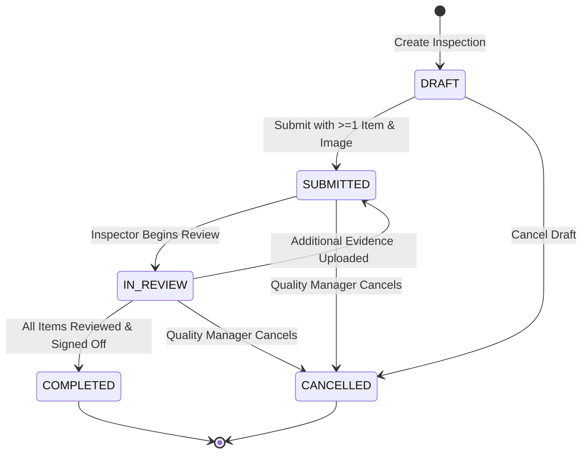
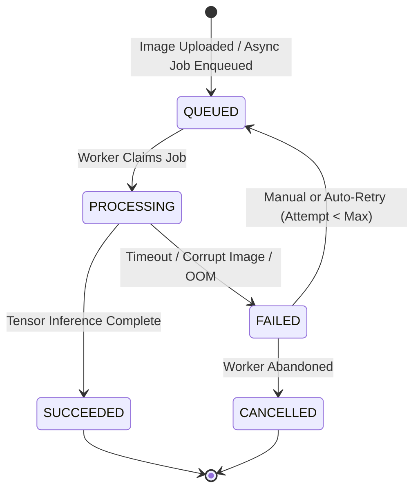
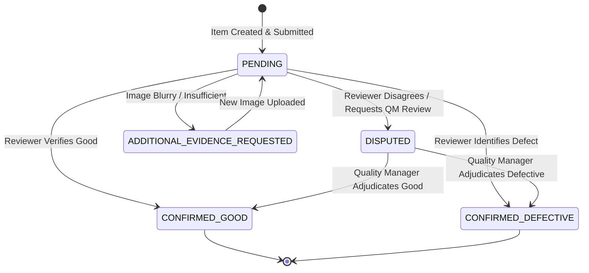
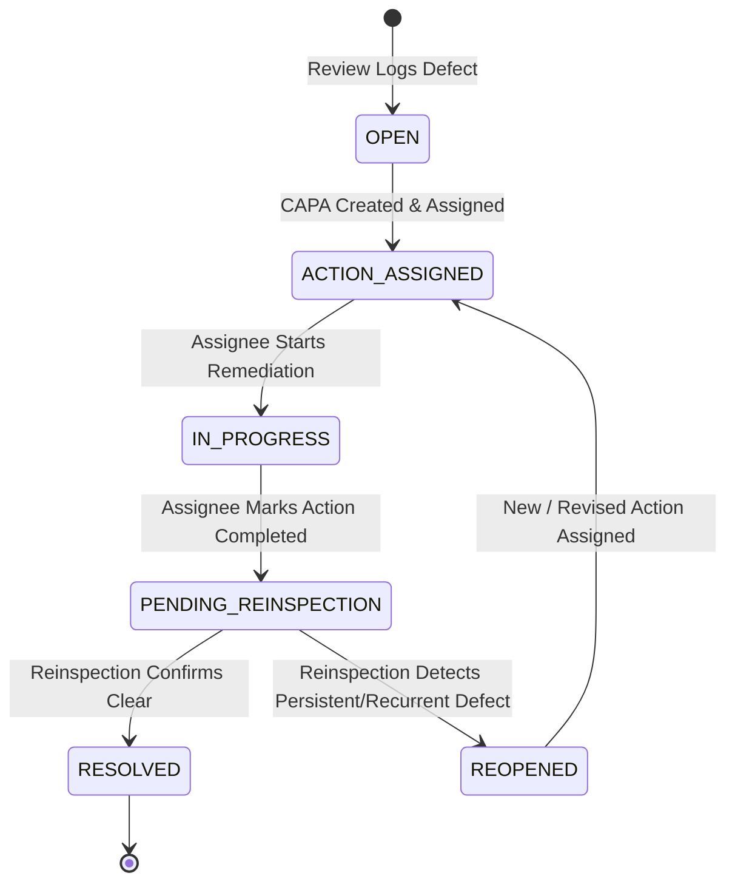
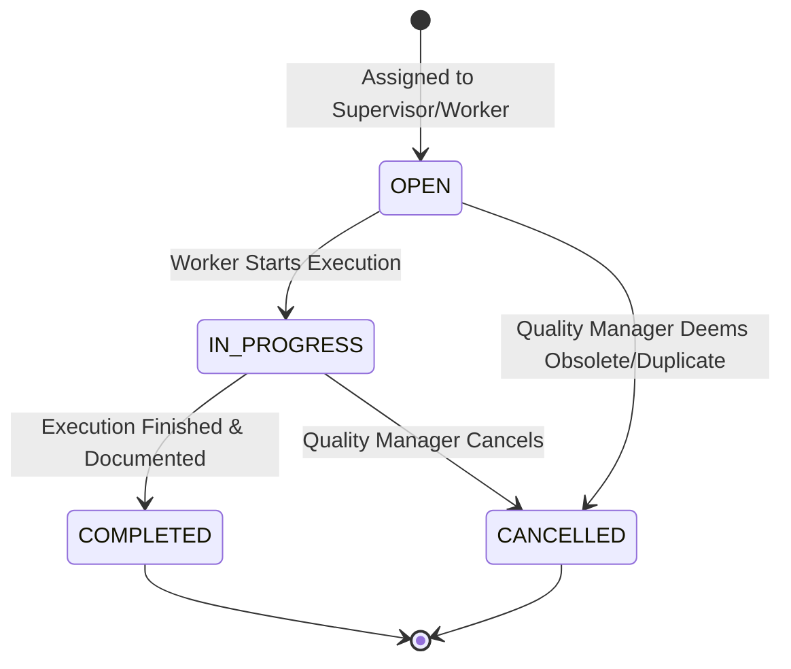
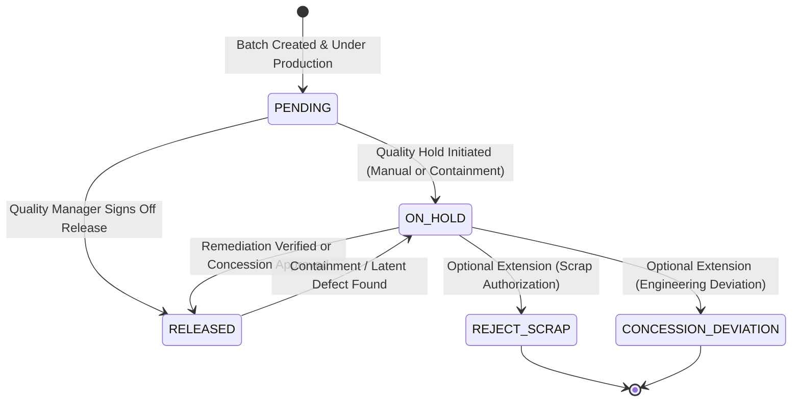

# CastTrace AI — State Machines & Workflow Transitions

**Document Version:** 1.0.0  
**Phase:** 1A (Architecture and Contracts)  
**Backend Enforcement:** Finite State Machine validation via FastAPI service layer + SQLAlchemy transactions.

---

## 1. Architectural Guardrails for State Machines

1. **Human Authority Rule:** Automated systems (ML pipelines, background workers, GenAI) **cannot** transition defects to `RESOLVED` or batches to `RELEASED`. Final operational sign-offs strictly require authenticated human credentials with appropriate roles.
2. **Explicit Uncertainty & Failure Handling:** Failures in image processing or ML inference do not leave the system in a hanging state. They transition to explicit states (`FAILED`), trigger audit alerts, and enable human fallback without blocking the inspection lifecycle.
3. **Transition Determinism:** Every state transition is validated against a whitelist of valid previous states. Any illegal transition triggers an HTTP `409 Conflict` (or `422 Unprocessable Entity`), logs a security warning in `audit_log`, and aborts the database transaction.

---

## 2. Inspection State Machine

### 2.1 Mermaid Diagram

### 2.2 Transition Table

| Previous State | New State | Permitted Role | Required Input / Trigger | Validation Rules | Expected Audit Event | Error Behavior |
| :--- | :--- | :--- | :--- | :--- | :--- | :--- |
| *None* | `DRAFT` | `INSPECTOR`, `SUPERVISOR`, `QUALITY_MANAGER` | `batch_id`, `sampling_plan`, `stage` | Batch must not be `ARCHIVED` or `SCRAPPED`. | `INSPECTION_CREATED` | `400 Bad Request` if batch invalid. |
| `DRAFT` | `SUBMITTED` | `INSPECTOR`, `SUPERVISOR` | Finalize upload action | Inspection must have $\ge 1$ `inspection_items` and $\ge 1$ non-superseded `images`. | `INSPECTION_SUBMITTED` | `422 Unprocessable Entity` ("Inspection must contain items and evidence before submission"). |
| `DRAFT` | `CANCELLED` | `INSPECTOR`, `QUALITY_MANAGER` | Cancellation reason | Must be in `DRAFT`. | `INSPECTION_CANCELLED` | `409 Conflict` if already submitted. |
| `SUBMITTED` | `IN_REVIEW` | `INSPECTOR`, `QUALITY_MANAGER` | Begin review action | System verifies all queued `model_runs` are terminal (`SUCCEEDED` or `FAILED`). | `INSPECTION_REVIEW_STARTED` | `409 Conflict` if ML jobs still `IN_PROGRESS` (unless manual bypass forced). |
| `IN_REVIEW` | `SUBMITTED` | `INSPECTOR`, `QUALITY_MANAGER` | Upload additional evidence | New image added due to dispute or insufficient evidence. | `INSPECTION_REOPENED_FOR_EVIDENCE` | `409 Conflict` if inspection already `COMPLETED`. |
| `IN_REVIEW` | `COMPLETED` | `INSPECTOR`, `QUALITY_MANAGER` | Complete sign-off | Every physical `inspection_items` in this inspection must have a completed `review`. | `INSPECTION_COMPLETED` | `422 Unprocessable Entity` ("Unreviewed items remain"). |
| `SUBMITTED`, `IN_REVIEW` | `CANCELLED` | `QUALITY_MANAGER` | Administrative reason | Permitted only by Quality Manager. | `INSPECTION_CANCELLED` | `403 Forbidden` if role is not Quality Manager. |

---

## 3. Model Run State Machine

### 3.1 Mermaid Diagram

### 3.2 Transition Table

| Previous State | New State | Permitted Role | Required Input / Trigger | Validation Rules | Expected Audit Event | Error Behavior |
| :--- | :--- | :--- | :--- | :--- | :--- | :--- |
| *None* | `QUEUED` | System / Worker | Image upload completed | Image exists, file size $\le 10\text{ MB}$, valid image magic bytes. | `MODEL_RUN_ENQUEUED` | `415 Unsupported Media` if corrupt. |
| `QUEUED` | `PROCESSING` | System (Worker process) | Worker heartbeat lock | Run must be in `QUEUED`. Worker sets `executed_at`. | `MODEL_RUN_STARTED` | `409 Conflict` if already claimed. |
| `PROCESSING` | `SUCCEEDED` | System (Worker process) | `predicted_label`, `score`, `processing_latency_ms` | `predicted_label` $\in \{\text{"GOOD"}, \text{"DEFECTIVE"}\}$, score $\in [0.0, 1.0]$. | `MODEL_RUN_SUCCEEDED` | `500 Internal Error` if label invalid. |
| `PROCESSING` | `FAILED` | System (Worker process) | `error_details` (stack trace/code) | Captures failure reason without deleting previous data. | `MODEL_RUN_FAILED` | Alert logged in system metrics. |
| `FAILED` | `QUEUED` | `INSPECTOR`, `QUALITY_MANAGER`, System | Retry request | Spawns **new** `model_runs` record with `parent_run_id` set and `attempt_number = prev + 1` (Max attempts: 3). | `MODEL_RUN_RETRIED` | `409 Conflict` if max retries exceeded. |

*Crucial Rule:* Failed model runs are never overwritten or deleted. They remain in the database for accuracy auditing. Human review can proceed immediately from a `FAILED` state without waiting for a retry.

---

## 4. Human Review & Dispute Resolution State Machine

### 4.1 Mermaid Diagram

### 4.2 Transition Table

| Previous State | New State | Permitted Role | Required Input / Trigger | Validation Rules | Expected Audit Event | Error Behavior |
| :--- | :--- | :--- | :--- | :--- | :--- | :--- |
| *None* | `PENDING` | System | Inspection submission | Item linked to inspection. | `REVIEW_INITIALIZED` | - |
| `PENDING` | `CONFIRMED_GOOD` | `INSPECTOR`, `QUALITY_MANAGER` | Reviewer notes (optional) | If latest `model_run.predicted_label == "DEFECTIVE"`, sets `model_disagreement = TRUE`. | `REVIEW_CONFIRMED_GOOD` | `409 Conflict` if already reviewed. |
| `PENDING` | `CONFIRMED_DEFECTIVE` | `INSPECTOR`, `QUALITY_MANAGER` | Defect payload (`category`, `severity`, `description`) | Defect category must be chosen from approved taxonomy. Automatically creates record in `defects`. | `REVIEW_CONFIRMED_DEFECTIVE` | `422 Unprocessable Entity` if category missing. |
| `PENDING` | `DISPUTED` | `INSPECTOR`, `SUPERVISOR` | Dispute rationale notes | Must specify reason for dispute (e.g., borderline porosity vs surface stain). | `REVIEW_DISPUTED` | `422 Unprocessable Entity` if notes empty. |
| `PENDING` | `ADDITIONAL_EVIDENCE_REQUESTED` | `INSPECTOR`, `QUALITY_MANAGER` | Defect description / Reason for request | Flags image as inadequate (e.g. angle reflection). | `REVIEW_EVIDENCE_REQUESTED` | `422 Unprocessable Entity` if reason empty. |
| `ADDITIONAL_EVIDENCE_REQUESTED` | `PENDING` | `INSPECTOR` | Upload replacement/supplementary image | New image linked to item, old image marked `is_superseded = TRUE`. | `REVIEW_EVIDENCE_SUPPLEMENTED` | `400 Bad Request` if no new image provided. |
| `DISPUTED` | `CONFIRMED_GOOD` | `QUALITY_MANAGER` | QM Adjudication notes | Only Quality Manager can resolve disputes. Sets `model_disagreement` accordingly. | `DISPUTE_RESOLVED_OVERRIDE` | `403 Forbidden` if role is not Quality Manager. |
| `DISPUTED` | `CONFIRMED_DEFECTIVE` | `QUALITY_MANAGER` | QM Adjudication notes + Defect payload | Creates confirmed defect record. | `DISPUTE_RESOLVED_CONFIRMED` | `403 Forbidden` if role is not Quality Manager. |

---

## 5. Defect Lifecycle State Machine

### 5.1 Mermaid Diagram

### 5.2 Transition Table

| Previous State | New State | Permitted Role | Required Input / Trigger | Validation Rules | Expected Audit Event | Error Behavior |
| :--- | :--- | :--- | :--- | :--- | :--- | :--- |
| *None* | `OPEN` | `INSPECTOR`, `QUALITY_MANAGER` | Review sign-off (`category`, `severity`) | Linked to `inspection_item_id` and `review_id`. | `DEFECT_LOGGED` | `422 Unprocessable Entity` if missing severity. |
| `OPEN` | `ACTION_ASSIGNED` | `SUPERVISOR`, `QUALITY_MANAGER` | `assigned_to`, `due_date`, `action_type`, `description` | `due_date` must be today or in future. Creates `corrective_actions` record. | `DEFECT_ACTION_ASSIGNED` | `422 Unprocessable Entity` if `due_date` in past. |
| `ACTION_ASSIGNED` | `IN_PROGRESS` | `SUPERVISOR`, Assignee | Acknowledge action | Action state updates to `IN_PROGRESS`. | `DEFECT_REMEDIATION_STARTED` | `409 Conflict` if action not assigned. |
| `IN_PROGRESS` | `PENDING_REINSPECTION` | `SUPERVISOR`, Assignee | `completion_notes`, evidence photos | Corrective action must be marked `COMPLETED`. | `DEFECT_REMEDIATION_COMPLETED` | `422 Unprocessable Entity` if `completion_notes` blank. |
| `PENDING_REINSPECTION` | `RESOLVED` | `INSPECTOR`, `QUALITY_MANAGER` | `reinspections` record with outcome `DEFECT_RESOLVED` | Follow-up inspection must show zero defects on this item. Authorized by human. | `DEFECT_RESOLVED` | `409 Conflict` if reinspection record missing. |
| `PENDING_REINSPECTION` | `REOPENED` | `INSPECTOR`, `QUALITY_MANAGER` | `reinspections` record with outcome `DEFECT_RECURRED_REOPENED` | Reinspection evidence exhibits persistent defect. | `DEFECT_REOPENED` | `422 Unprocessable Entity` if reopen notes missing. |
| `REOPENED` | `ACTION_ASSIGNED` | `SUPERVISOR`, `QUALITY_MANAGER` | New action payload | Reassigns corrective action with updated due date. | `DEFECT_REASSIGNED` | `409 Conflict` if previous action still active. |

---

## 6. Corrective Action State Machine

### 6.1 Mermaid Diagram

### 6.2 Transition Table

| Previous State | New State | Permitted Role | Required Input / Trigger | Validation Rules | Expected Audit Event | Error Behavior |
| :--- | :--- | :--- | :--- | :--- | :--- | :--- |
| *None* | `OPEN` | `SUPERVISOR`, `QUALITY_MANAGER` | `defect_id`, `assigned_to`, `due_date` | `due_date` $\ge \text{today}$. | `ACTION_CREATED` | `422 Unprocessable Entity`. |
| `OPEN` | `IN_PROGRESS` | Assignee, `SUPERVISOR` | Start notification | - | `ACTION_STARTED` | `409 Conflict` if already completed. |
| `IN_PROGRESS` | `COMPLETED` | Assignee, `SUPERVISOR` | `completion_notes`, optional photo | Notes must have $\ge 10$ characters describing fix. | `ACTION_COMPLETED` | `422 Unprocessable Entity` if notes too short. |
| `OPEN`, `IN_PROGRESS` | `CANCELLED` | `QUALITY_MANAGER` | Justification note | Only Quality Manager can cancel actions. | `ACTION_CANCELLED` | `403 Forbidden` if not Quality Manager. |

---

## 7. Batch Decision State Machine

### 7.1 Mermaid Diagram

### 7.2 Core Batch Decisions vs. Operational Containment Hold

1. **Operational Containment Hold (`POST /batches/{id}/hold`):**
   - Placed immediately by shop-floor personnel (`INSPECTOR`, `SUPERVISOR`, `QUALITY_MANAGER`) whenever visual non-conformance or immediate containment is needed during staging or production. Halts shipment and movement immediately (`status = "ON_HOLD"`).
2. **Official Batch Decisions (`POST /batches/{id}/decisions`):**
   - Authorized solely by a `QUALITY_MANAGER` (`INSPECTOR` and `SUPERVISOR` receive `403 Forbidden`).
   - Records formal engineering governance in `batch_decisions`.
   - **Mandatory Core Decisions:**
     - **`HOLD`:** Official quality hold decision recorded in the governance ledger.
     - **`RELEASE`:** Authorizes release of the batch into finished goods or customer shipment.
   - **Optional Extension Outcomes:**
     - **`REJECT_SCRAP`:** Optional terminal outcome for severe, unrecoverable casting lots where remediation is economically or metallurgically unfeasible.
     - **`CONCESSION_DEVIATION`:** Optional specialized outcome for controlled engineering releases under a formal customer or engineering concession permit.

### 7.3 Release Policy Regarding Open Defects & Release Gates

- **Documented Quality Policy:** An open defect or unverified quality state strictly prevents routine batch release.
  - *Standard Release Gate:* Evaluates the current batch state across 6 mandatory verification domains:
    1. **Inspection Completeness:** Requires all batch inspections to be in terminal completed states (`COMPLETED`) and all distinct physical items to have reached eligible terminal quality states (`CLEAR` or resolved).
    2. **Evidence & Inference:** Validates that evidence images exist, SHA-256 hashes are verifiable, and no required model runs are queued, processing, or failed.
    3. **Human Review & Disputes:** Confirms that 100% of physical items have completed human reviews without pending disputes (`DISPUTED`) or outstanding evidence requests (`REQUEST_ADDITIONAL_EVIDENCE`).
    4. **Defect Management:** Confirms no open, action-assigned, in-progress, or reopened defects exist for the batch.
    5. **CAPA & Reinspection:** Confirms all corrective actions are `VERIFIED` by an independent verifier and follow-up reinspection confirms `DEFECT_RESOLVED`.
    6. **State & Authorization:** Confirms batch is in a non-terminal state (`PENDING` or `ON_HOLD`), decision maker has `QUALITY_MANAGER` role, and atomic conditional update succeeds.
  - *Authorized Concession Release:* If an open non-critical defect remains (e.g. minor cosmetic roughness within allowable drawing tolerance), the **Quality Manager remains solely empowered** to authorize release by setting `is_concession: true` and providing an explicit documented engineering justification (`concession_justification`).
  - *Concurrency Protection:* Release gates are re-evaluated within the database transaction using atomic conditional state checks (`status == prev_status`), returning HTTP `409 Conflict` if concurrent modifications or stale evaluations occur.
  - *Decision Snapshot Immutability:* Every finalized decision (`RELEASE` or `HOLD`) persists a frozen JSON snapshot capturing exact item counts, quality metrics, active blocker codes, and entity identifiers at decision time. Later database modifications never mutate historical decision snapshots.

### 7.4 Transition Table

| Previous State | New State | Action / Decision Class | Permitted Role | Required Input / Trigger | Validation & Policy Rules | Expected Audit Event | Error Behavior |
| :--- | :--- | :--- | :--- | :--- | :--- | :--- | :--- |
| *None* | `PENDING` | System | System | Batch creation | - | `BATCH_INITIALIZED` | - |
| `PENDING`, `RELEASED` | `ON_HOLD` | **Operational Containment Hold** | `INSPECTOR`, `SUPERVISOR`, `QUALITY_MANAGER` | Containment reason | Immediate operational hold on shop floor (`POST /batches/{id}/hold`). Reason must be recorded. Batch immediately blocked from shipping. Captures hold decision snapshot. | `BATCH_HELD` | `422 Unprocessable Entity` if reason missing; `401 Unauthorized` if unauthenticated. |
| `PENDING`, `ON_HOLD` | `RELEASED` | **Official Batch Decision** | `QUALITY_MANAGER` | Formal justification (+ optional concession text if open defects exist) | Evaluates release gates in transaction (`POST /batches/{id}/decisions`). If blockers exist, requires `is_concession: true` and `concession_justification`. Persists immutable snapshot and updates batch to `RELEASED`. | `BATCH_RELEASED` | `403 Forbidden` if Inspector/Supervisor; `422 Unprocessable Entity` if blockers present; `409 Conflict` on concurrent state change. |
| `PENDING`, `RELEASED` | `ON_HOLD` | **Official Batch Decision** | `QUALITY_MANAGER` | Containment reason | Authorized only by Quality Manager via `POST /batches/{id}/decisions`. Recorded in `batch_decisions` with snapshot. | `BATCH_DECISION_RECORDED` | `403 Forbidden` if Inspector/Supervisor; `422 Unprocessable Entity` if reason missing; `409 Conflict` on concurrent change. |
| `ON_HOLD` | `REJECT_SCRAP` | *Official Decision (Extension)* | `QUALITY_MANAGER` | Scrap authorization | Authorized only by Quality Manager. Critical non-conformance documented. All open actions closed as scrap. | `BATCH_SCRAPPED` | `403 Forbidden` if not Quality Manager. |
| `ON_HOLD` | `CONCESSION_DEVIATION`| *Official Decision (Extension)* | `QUALITY_MANAGER` | Concession permit number + engineering sign-off | Authorized only by Quality Manager. Formal engineering concession permit recorded. | `BATCH_RELEASED_WITH_CONCESSION`| `403 Forbidden` if not Quality Manager; `422 Unprocessable Entity` if permit missing. |

*Crucial Rule:* Batch decisions are completely decoupled from individual inspection results. An individual inspection finishing does NOT automatically release the batch. Only an authorized human `QUALITY_MANAGER` can make official batch decisions.

